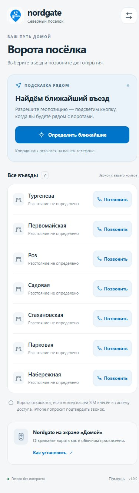

# Локальная проверка Nordgate PWA

Дата: 30 октября 2026 года.

## Результаты

- `npm run build`: проверка TypeScript и JSON, production-сборка и создание офлайн-выпуска выполнены успешно.
- `npm test`: 18 проверок, все успешны. Покрыты радиусы и тренд приближения, отмена/повторное нажатие, свежесть и точность координат, повреждённые настройки, жизненный цикл геолокации и согласованный кэш.
- `npm run check:android -- "E:/#prjw/tsn/nordgate/Resources/Raw/phones.json"`: все 7 записей совпадают.
- При установке зависимостей npm сообщил об отсутствии известных уязвимостей.
- В браузере проверены все 7 телефонных ссылок, настройки, инструкция установки и справка. Реальные номера ворот в процессе проверки не набирались.
- Настройки менялись через интерфейс; после перезагрузки и применения новой версии сохранились.
- Проверено обнаружение ожидающей версии и применение кнопкой «Обновить».
- После полной остановки локального HTTP-сервера страница повторно загрузилась из Service Worker: интерфейс, JSON, CSS, JS и справка доступны.
- Повторена проверка на адресе `/nordgate/` с имитацией GitHub Pages и заголовком `Vary: Origin`; после остановки этого сервера повторная загрузка тоже успешна.
- Проверены размеры окна 320×740, 390×844 и 1024×900. Горизонтальной прокрутки нет; кнопки звонка имеют высоту не менее 44 CSS-пикселей.
- После применения исправленного выпуска в браузерном журнале ошибок и предупреждений не обнаружено.

При проверке обнаружено и исправлено несовпадение кэша ресурсов из-за `Vary: Origin`: запросы ES-модулей и предварительного кэширования могут иметь разные заголовки Origin. Добавлена отдельная проверка. Сопоставление без Vary применяется только к публичным статическим ресурсам собственного origin и каталога приложения.

Также исправлена горизонтальная прокрутка на узком окне с обычной полосой прокрутки.

## Что не проверено

Настоящие iPhone, системные разрешения Safari, установленный режим iOS, выбор SIM и телефонные вызовы на реальных воротах пока не испытаны. Получение геопозиции проверено алгоритмически и через тестовый адаптер, без выдачи браузеру доступа к настоящей позиции пользователя.

Остановка локального сервера проверяет отсутствие доступности origin, но не воспроизводит все режимы отключения мобильных данных, очистки iOS-хранилища и приостановки приложения. Эти проверки входят в [пилот на iPhone](iphone-pilot.md).

## Публикация

Локальная проверка выше выполнена до подключения GitHub; тестовые серверы после неё остановлены.

2 ноября 2026 года проект подготовлен для публикации в репозитории [nordposelok/nordgate](https://github.com/nordposelok/nordgate). GitHub Pages публикуется через `.github/workflows/pages.yml`. Адрес приложения — [nordposelok.github.io/nordgate](https://nordposelok.github.io/nordgate/). Состояние сборок и развёртываний доступно в [GitHub Actions](https://github.com/nordposelok/nordgate/actions). `vercel.json` сохранён как альтернативный вариант размещения.

## Снимок интерфейса

Размер окна 390×844, снимок всей страницы:

